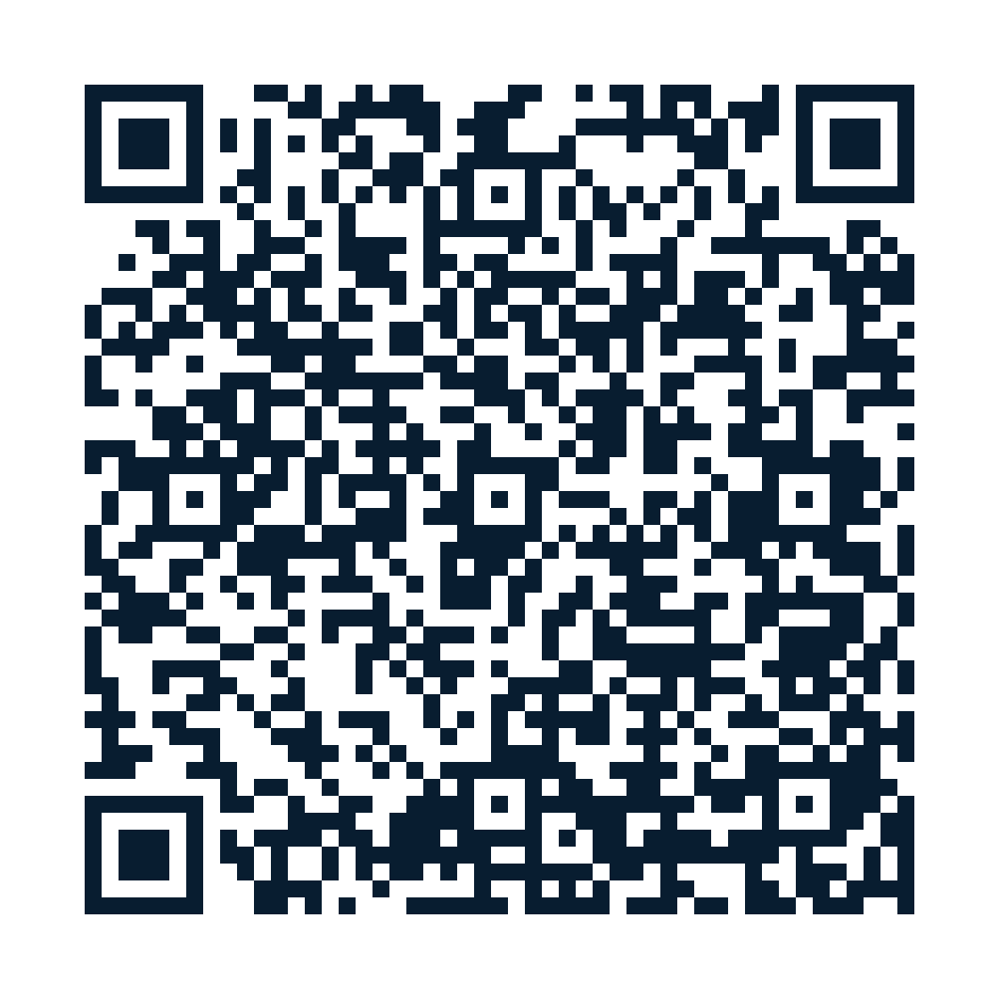

# Support The Age of Free Programming

**One prompt. Your computer. Your rules.**

The Age of Free Programming is a free educational project helping people learn to build, supervise, and preserve their own AI projects using ordinary tools and documented evidence. It is inspired by public Seraph operating principles, but **does not provide access to any private Seraph system**.

If these materials help you, you may choose to support continued research, documentation, maintenance, and educational development. **Giving is completely voluntary: no contribution is needed to read the guides, copy the permitted community prompts, or use the free educational materials.**

> **Payment links are not yet enabled.** This page is being prepared for public review. Please do not send money using old graphics, unofficial profiles, messages, or previously circulated payment handles. Approved payment destinations will appear here only after the owner verifies the recipient and authorizes public disclosure.

## Support options

| Method | Current status |
| --- | --- |
| Cash App | **Pending** recipient verification and public-use authorization |
| Venmo | **Pending** recipient verification and public-use authorization |
| PayPal | **Pending** recipient verification and public-use authorization |
| Other payment methods | **Not enabled**; subject to owner review and privacy checks |

No banking details, account identifiers, personal email addresses, phone numbers, payment requests, or direct-payment QR codes are published on this page.

## Save or share the support-page QR

**QR destination:** https://github.com/SeraphPLC/age-of-free-programming/blob/main/SUPPORT.md

The QR links to **this GitHub page**, not to a payment provider or personal account. The link is intended to remain stable as payment options are separately reviewed and enabled. Until the page is on the main branch, scanning may lead to a page that does not exist.

[Preview the shareable donation poster](assets/support/support-poster.png) · [Vector poster](assets/support/support-poster.svg) · [QR image](assets/support/support-hub-qr.png)

The poster is marked *draft* while payment options remain unverified. Do not represent the graphics as confirmation that donations can already be accepted.

## What a contribution means

- **Not a purchase:** Educational materials remain free whether or not you contribute.
- **No special rights:** Contributions do not grant private access, AI accounts, extra permissions, voting rights, intellectual-property rights, or project ownership.
- **Not an investment:** There are no shares, returns, profit participation, or guaranteed outcomes.
- **Not a charitable deduction claim:** Contributions are not represented as tax-deductible charitable donations.
- **Separate from business transactions:** Any commercial services, organizational partnerships, or equity proposals require their own documented terms and channels.

When verified payment options are published, always confirm the recipient **inside the payment provider's official app or website before sending funds**. This educational repository does not request payment credentials and does not process donations directly.

## Keep this project free and safe

The free [Get Seraphed community guide](prompts/GET_SERAPHED_COMMUNITY_R1_LIVING.md) and [beginner start page](README.md) remain available without payment. Financial records, private Seraph information, and payment credentials must not be submitted to GitHub issues, pull requests, or AI chats.

For this project's confidentiality, rights, and release practices, see the [public output disclosure gate](docs/OUTPUT_DISCLOSURE_GATE.md) and [release policy](docs/PRIVACY_IP_AND_RELEASE_GATE.md).

**Get Seraphed. The mission outlives the model.**
