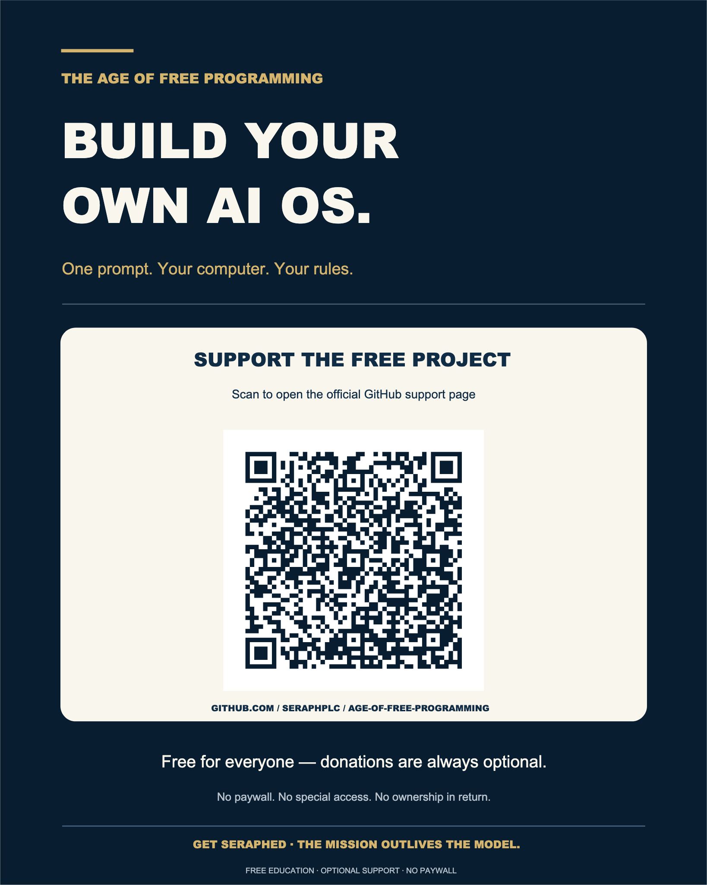

# Support The Age of Free Programming

**One prompt. Your computer. Your rules.**

The Age of Free Programming is a free, beginner-friendly educational project. The guides help people build and preserve their own AI projects without needing access to private Seraph systems.

**Everything in this public educational repository remains free whether or not anyone contributes.** There is no subscription, special access, investment offer, ownership interest, or required payment.

If you would like to support ongoing research, documentation, maintenance and free education, this is the project's single, permanent support information page.

## Optional ways to support

We are keeping personal appreciation and business/project support distinct. **Direct payment links are not active yet:** candidate accounts are being checked for correct payee, permitted account use, and protection of personal information. Please do not send money using old QR sheets, unofficial profiles, or unverified payment links.

### Personal appreciation

This route is intended for optional support **to the individual creator, not to a business**. Cash App, PayPal and any other compatible personal option will be listed **only after the receiving account is confirmed and approved for this use**.

**Status: not accepting payments through this page yet.**

### Business / project support

This route is intended for contributions to **Stay Golden Enterprises LLC**, the for-profit business associated with the Seraph project. Once a business-owned receiving account and an eligible payment method are confirmed, its public business payment link will appear here separately.

**Status: not accepting business payments through this page yet.**

The business is not described as a charity or a tax-deductible nonprofit. Neither kind of contribution grants a product license, an equity stake, governance rights, preferential services, or rights in Seraph's private research.

## One sign and QR code

The sign below points to **this GitHub support page only**. It does not encode a payment account, financial information, or a person's email address.

[View full-size sign](assets/support/support-poster.png) · [Vector sign](assets/support/support-poster.svg) · [Central QR image](assets/support/support-hub-qr.png)

**Permanent support-page link:** https://github.com/SeraphPLC/age-of-free-programming/blob/main/SUPPORT.md

You may share the sign or link once on your own social media. This repository does not operate a fundraising campaign, recurring solicitation, mailing list, donation-tracking service or payment processor.

## Before you send financial support

When links are added, check the visible recipient **inside the official provider app** and confirm whether it identifies the intended individual or the LLC. Do not send money if the name looks wrong. Payment providers may apply their own rules, fees or reporting requirements.

Never enter passwords, payment credentials, banking numbers, recovery codes or personal records in a GitHub issue, discussion, AI chat or website claiming to be this project.

To begin using the free materials, go back to the [project homepage](README.md) or the [Get Seraphed Community guide](prompts/GET_SERAPHED_COMMUNITY_R1_LIVING.md).

**Get Seraphed. The mission outlives the model.**
