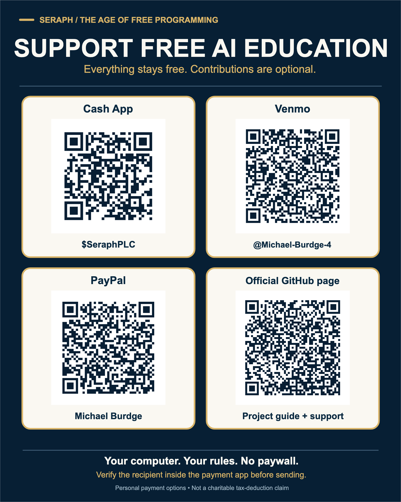
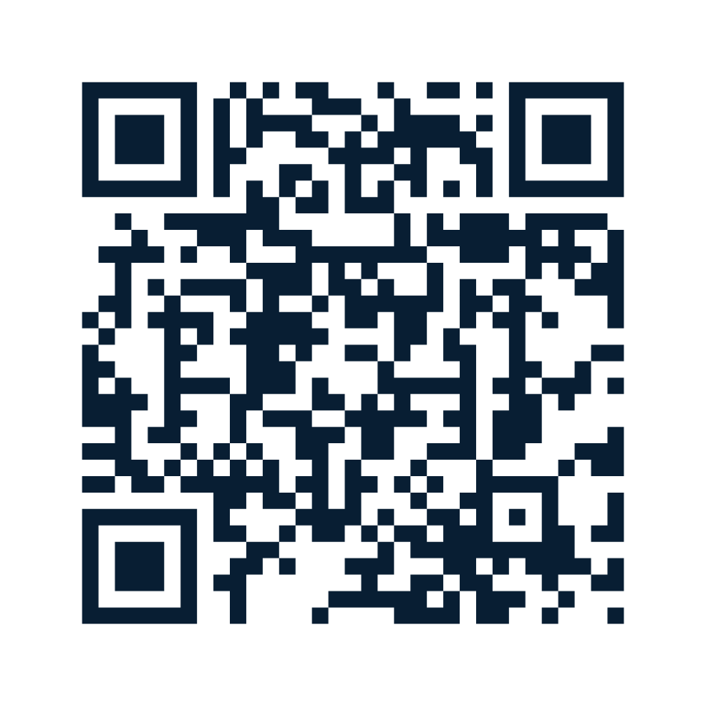
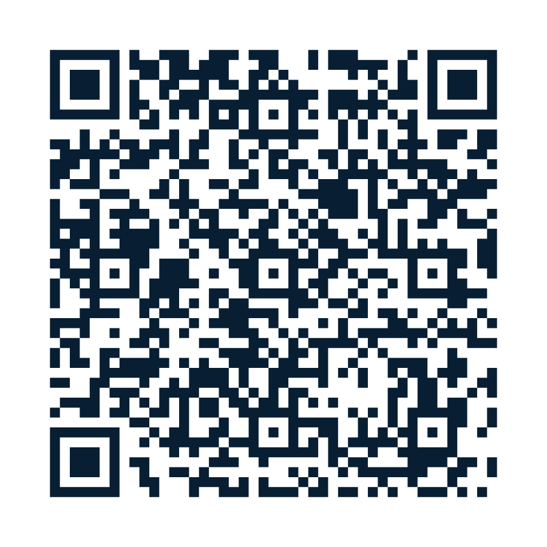
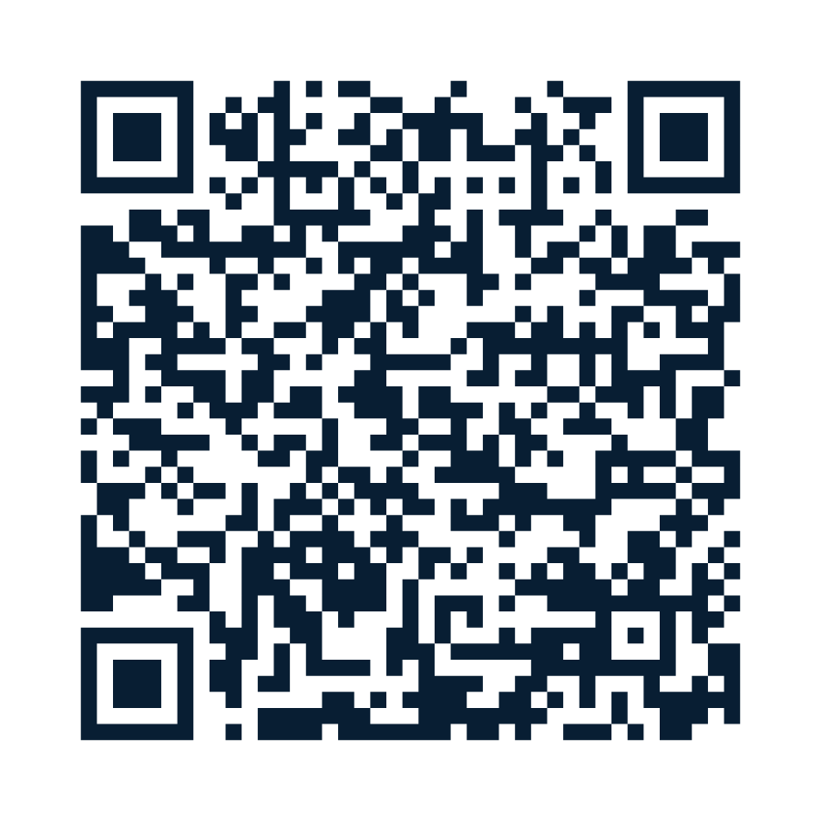

# Support The Age of Free Programming

**One prompt. Your computer. Your rules.**

**Everything here is free, whether you contribute or not.** This public educational project helps people learn to build, supervise, and preserve their own AI work. It does not grant access to any private Seraph system. No purchase, subscription, contribution, or outside payment service is required to use the free guides.

## Optional support — Cash App, Venmo, PayPal

The image below contains **three personal payment options** plus a QR for this GitHub page. Each QR was rebuilt from the exact destination in the owner's current account screenshots, then independently decoded from the exported final graphic.

**[View the full-size image](assets/support/support-payment-options.png)** · [Vector artwork](assets/support/support-payment-options.svg) · [Copy the official support-page link](https://github.com/SeraphPLC/age-of-free-programming/blob/main/SUPPORT.md)

The recipient shown in the source screenshots for these personal payment profiles is **Michael Burdge**. All three destinations are **personal support routes, not verified business receiving accounts**. Confirm the name and receiving account inside the official payment app before sending any money. A scanned QR proves its encoded URL, not ongoing control of an account or eligibility for a particular payment type.

### Cash App — $SeraphPLC

[**Open Cash App payment profile**](https://cash.app/$SeraphPLC?qr=1)

### Venmo — @Michael-Burdge-4

[**Open the Venmo code/profile**](https://venmo.com/code?user_id=3164971651301376557&created=1792913852.040818)

### PayPal — Michael Burdge

[**Open the PayPal payment code**](https://www.paypal.com/qrcodes/p2pqrc/3XHYCY3JZG3AC)

### Business / project payments

No independently verified payment account for Stay Golden Enterprises LLC has been approved for public use. The personal payment codes above **must not be described as payments to the LLC**. A separate business link may be added later only when the receiving entity, provider eligibility, public display and ownership have been verified.

### Zelle privacy restriction

Zelle is **not included** in this public image or page. The original Zelle QR code contains a personal payment email within the encoded destination, even if the email is visually hidden beneath a new design. Removing the visible words cannot remove the embedded QR payload while keeping the same working payment code.

## Free education, always

No contribution provides special access, software licenses, project equity, ownership, governance rights, investment returns or preferential permissions. Contributions are **not represented as charitable tax-deductible donations**. Payment services may apply their own eligibility rules, fees and reporting requirements. Use the correct transaction category in each service; never mislabel a commercial payment as a friends-and-family transfer.

This project is **not running a fundraising campaign**. This is a static, voluntary support sign, not a recurring solicitation, processor, payment form, mailing list or subscription. We do not collect payment credentials, banking records or private contact information through GitHub.

**[Start using the free educational materials](README.md)** · [Get Seraphed community prompt](prompts/GET_SERAPHED_COMMUNITY_R1_LIVING.md)

**Get Seraphed. The mission outlives the model.**
