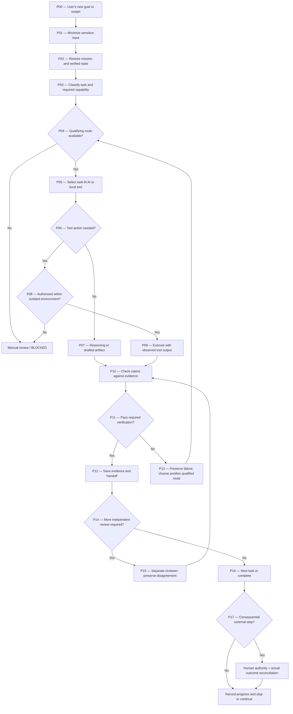

# The Community Neural Routing Atlas

**Public educational blueprint · Seraph-aligned observable behavior · October 2026**

**What you asked to map:** from an incoming port, to the AI or tool that is appropriate for the job, to the next independent AI, validator, memory store, and human decision—and **every viable alternative at each decision point**.

**Privacy and intellectual-property boundary:** This is a **clean-room public reference design**, derived from Seraph's documented *functional principles*: mission-first operation, discover existing capabilities before inventing paths, fit the specific task, reject unqualified routes, preserve evidence, distinguish communication from authority, prefer continuity over chat memory, and reconcile uncertain actions before retrying. It is **not** an export of the private Seraph Mesh topology, actual routing weights, production algorithms, internal node identities, security mechanisms, provider entitlements or operational endpoints. The exact private implementation cannot safely be reproduced in a public map. What readers can build is an **independent system with the same observable workflow goals**.

## Atlas: read in this order

| Layer | Public build document | What it answers |
| --- | --- | --- |
| 0 — Concepts | [Seraph's public neural anatomy](../architecture/README.md) | What are neurons, dendrites, memory and the controlling human? |
| 1 — Ports | [Entry ports, decision gates and output ports](01_PORTS_AND_DECISION_POINTS.md) | Where does every category of signal enter, exit or stop? |
| 2 — Routes | [Port → AI → next AI maps](02_PORT_TO_AI_TO_AI_MAPS.md) | Which AI can work next, what are the other choices, and why? |
| 3 — Choice | [Capability, privacy and provider fallback matrix](03_PROVIDER_OPTIONS_AND_FALLBACKS.md) | How do you choose among models, CLIs, chat, MCP and tools? |
| 4 — Continuity | [Work records, evidence and succession](04_HANDOFF_EVIDENCE_AND_RECOVERY.md) | What survives a changed model, failed connection or interrupted action? |
| 5 — Build | [Atomic learner build and adversarial test plan](05_ATOMIC_BUILD_AND_TEST_LAB.md) | How can an ordinary person build and objectively check an independent router? |
| 6 — Privacy | [Safe publication and security boundaries](06_PRIVACY_AND_TRUST_BOUNDARIES.md) | Which data stays local and when must a worker stop? |
| 7 — Demonstration | [Synthetic project traced across three AIs](07_THREE_AI_SYNTHETIC_TRACE.md) | What actually passes from one reasoning worker to the next? |
| 8 — Behavioral fidelity | [Seraph-aligned observable contract](08_SERAPH_ALIGNED_BEHAVIORAL_CONTRACT.md) | What must happen exactly, what alternatives must be offered, and where private behavior is deliberately not replicated? |
| 8B — Decision fidelity matrix | [Every decision atom and alternate route](08_FIDELITY_AND_ALTERNATIVE_MATRIX.md) | Detailed side-by-side preferred choices, other options, STOP conditions and observable evidence for each functional decision |
| 8 — Fidelity | [Seraph-aligned behavioral contract and alternatives](08_SERAPH_ALIGNED_BEHAVIORAL_CONTRACT.md) | Which externally observable Seraph decisions are preserved exactly, and where are private mechanisms withheld? |

Companion resources:
- [Frontier AI access methods](../FRONTIER_AI_ACCESS_METHODS.md): official public chat, CLI/IDE, and API choices.
- [Optional authorized computer setup](../RECOMMENDED_COMPUTER_SETUP.md): privacy-aware remote/local computer tools.
- [Staged offline builder](../STAGED_BUILD_PATH.md): build local continuity first.
- [Neural-analogy glossary](../architecture/NEURAL_ANALOGY_GLOSSARY.md): analogies are not biological neural implementation.
- [Privacy/IP release gate](../PRIVACY_IP_AND_RELEASE_GATE.md): public disclosure controls.

The [behavioral fidelity contract](08_SERAPH_ALIGNED_BEHAVIORAL_CONTRACT.md) and [decision-by-decision alternative matrix](08_FIDELITY_AND_ALTERNATIVE_MATRIX.md) together form the controlling public checklist for remaining faithful to Seraph's **observable** startup, route qualification, fallback, execution evidence, recovery, permission and stop semantics. It cannot be treated as access to private source or an exact copy of hidden algorithms.

## Seven immutable public principles

1. **Mission persists; workers change.** A model's conversation is not the project's only memory.
2. **Known does not mean healthy.** Check only the relevant route, with current evidence.
3. **Connected does not mean qualified or authorized.** A functioning link is not permission to act.
4. **Qualification outranks marketing labels.** Select a provider for the particular job it has actually demonstrated.
5. **Evidence outranks confident prose.** A claim of passing tests is not a test receipt.
6. **Do not blindly repeat ambiguous external actions.** Reconcile first or stop for human review.
7. **Alternatives are conditional, not automatic.** If every suitable path fails the applicable gates, use safe manual handoff or mark the task BLOCKED.

## Public decision picture

This graph shows **logical behavior**, not private node/edge structures or instructions for bypassing authorization. The expanded documents describe every port, fallback and stop point.

## Implementation and truth labels

- **SOURCE-ALIGNED PRINCIPLE:** documented Seraph operating philosophy or public engineering requirement.
- **PUBLIC REFERENCE:** generic, original learning-system example; not the same as Seraph's private implementation.
- **USER OPTION:** externally documented AI/tool path a reader may choose with their own accounts.
- **VERIFIED IN THIS REPOSITORY:** documentation and synthetic tests explicitly performed and recorded.
- **NOT VERIFIED:** a live provider call, novice installation, productivity gain, or full-system deployment that has not actually occurred.

**A map of available options is not a record of executed options.** No outside AI was dispatched simply because its name appears in the charts.

The goal: **give readers a reproducible, safe, user-owned path to Seraph-like continuity while the protected Seraph implementation remains private.**
